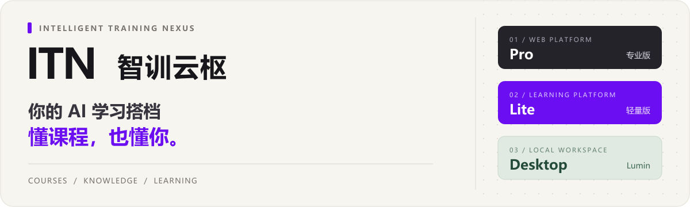
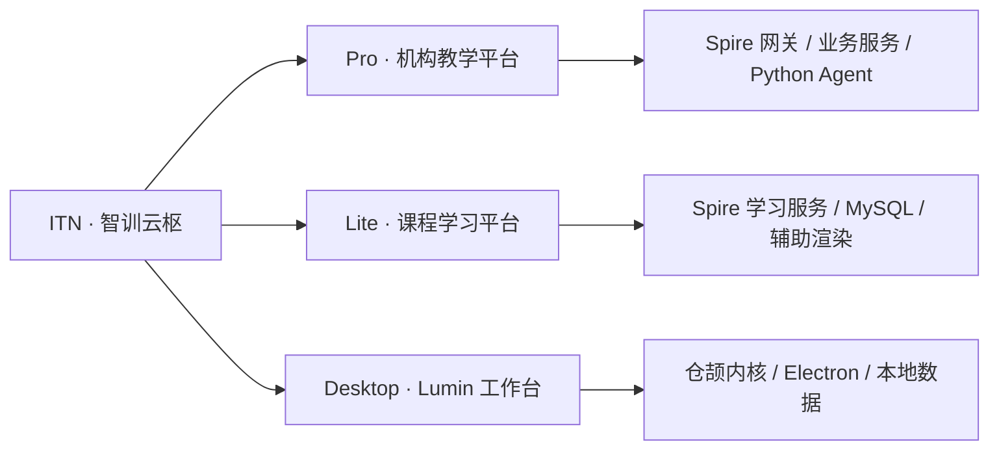

<p align="center">
  
</p>

<p align="center">
  <a href="versions/pro"></a>
  <a href="versions/lite"></a>
  <a href="versions/desktop"></a>
  
</p>

<p align="center">
  <a href="#editions">选择版本</a> &nbsp;·&nbsp;
  <a href="#quick-start">开始使用</a> &nbsp;·&nbsp;
  <a href="#architecture">项目架构</a> &nbsp;·&nbsp;
  <a href="#contributing">参与开发</a>
</p>

**ITN（Intelligent Training Nexus）** 是基于仓颉的学习与教培项目。你可以围绕课程和个人资料提问、生成学习材料、完成练习，再通过学习画像和记录安排后续学习。

这里集中维护 **Pro、Lite、Desktop** 三个版本：机构可以部署在线平台，学习者也可以在自己的电脑上使用 Lumin。

<a id="editions"></a>

## 选择适合你的版本

| | **Pro · 专业版** | **Lite · 轻量版** | **Desktop · Lumin** |
| :-- | :-- | :-- | :-- |
| 使用方式 | 浏览器访问，机构部署 | 浏览器访问，轻量部署 | Windows 本地应用 |
| 适合场景 | 组织教学、课程与知识管理 | 课程学习、小型教学与演示 | 围绕个人资料学习与工作 |
| 主要能力 | 知识网络、学习资源、伴学对话、笔记与错题、学习画像 | 资料包入库、讲义 / 幻灯片 / 习题、Lumin 对话、画像与学习计划 | 本地知识库、Lumin Agent、材料生成、学习与工作记录 |
| 服务组成 | 仓颉 Spire 网关 + 业务服务 + Python Agent | 仓颉 Spire 学习服务 + MySQL；Python 辅助渲染 | 仓颉内核 + Electron 外壳 + Lumin 运行时 |
| 仓颉 SDK | 1.1.3 | 1.2.0 | 1.2.0 |
| 模型配置 | 管理员统一配置 | 管理员统一配置 | 使用者自行配置 |
| 源码 | [versions/pro](versions/pro) | [versions/lite](versions/lite) | [versions/desktop](versions/desktop) |
| 进一步了解 | [专业版说明](versions/pro/README.md) | [轻量版说明](versions/lite/README.md) | [桌面版产品定义](versions/desktop/PRODUCT.md) |

三套实现分别管理依赖、配置与数据。请从对应版本目录启动，不要在版本之间直接复用数据库配置。

<a id="quick-start"></a>

## 开始使用

```bash
git clone git@github.com:AGI-FBHC/ITN-cj.git
cd ITN-cj
```

克隆默认分支即可获得三套源码。完整环境配置和运行顺序见 **[开发与启动指南](docs/GETTING_STARTED.md)**。

<details>
<summary><b>Pro：部署在线教学平台</b></summary>

进入专业版目录，按版本说明配置数据库、仓颉网关、业务服务与 Agent 服务。

```bash
cd versions/pro/apps/web
npm ci
npx vite build
```

前端静态打包沿用 [Pro 前端说明](versions/pro/apps/web/README.md) 中的 Vite 入口；完整类型检查仍有该版本记录的历史遗留项。

[架构、环境与接口](versions/pro/README.md) · [部署说明](versions/pro/deploy/web/README.md)

</details>

<details>
<summary><b>Lite：搭建课程学习环境</b></summary>

Lite 的网页前端与仓颉学习服务分别运行。首次启动需要准备本版本的数据库及环境配置。

```powershell
cd versions/lite
npm ci --prefix apps/web
npm run dev --prefix apps/web
```

另开一个 PowerShell 7 终端，在同一版本目录运行后端：

```powershell
.\scripts\run-backend.ps1
```

[初始化与运行说明](versions/lite/README.md) · [部署手册](versions/lite/docs/deploy-6024.md)

</details>

<details>
<summary><b>Desktop：在自己的电脑上使用 Lumin</b></summary>

桌面端使用仓颉 1.2.0 内核和 Electron 外壳。先配置本机 SDK、STDX、OpenSSL，再构建内核：

```powershell
cd versions/desktop
.\scripts\build.ps1
.\scripts\package.ps1
npm ci --prefix shell
npm start --prefix shell
```

[产品与使用范围](versions/desktop/PRODUCT.md) · [构建与开发约定](versions/desktop/AGENTS.md)

</details>

<a id="architecture"></a>

## 一份仓库，三个入口

```text
ITN-cj/
├── versions/
│   ├── pro/                 专业版：网页、网关、业务服务、Agent
│   ├── lite/                轻量版：课程、Lumin、画像与计划
│   └── desktop/             桌面版：本地内核、Electron、Lumin
├── docs/
│   ├── GETTING_STARTED.md   版本环境与启动入口
│   └── REPOSITORY.md        分支、导入来源与历史保留说明
├── archive/legacy-main/     整合前 main 的完整文件快照
├── AGENTS.md                跨版本协作约定
└── TRACE.md                 仓库级变更与交接记录
```



<a id="contributing"></a>

## 参与开发

- 从 `main` 创建功能分支，一次提交聚焦一个版本；跨版本变更在 PR 中说明影响范围。
- 在版本目录内构建和测试。环境文件、模型密钥、数据库、依赖和构建产物不提交。
- 将变更目的、验证结果和交接事项追加到根 [TRACE.md](TRACE.md)。
- 通过 PR 合并，选择 **Create a merge commit**，保留成员的原始提交与作者记录。

现有 `itn-pro`、`itn-lite`、`desktop` 分支继续保留。整合时的来源提交、快照标签及后续同步规则见 [仓库组织说明](docs/REPOSITORY.md)。

### 感谢每一位贡献者

本仓库沿用 [原 ITN 项目](https://github.com/AGI-FBHC/ITN)的学习与训练方向。我们通过保留原始提交历史接入三套实现，记录成员在各阶段的工作。

[查看贡献者](https://github.com/AGI-FBHC/ITN-cj/graphs/contributors) · [查看 Pull Requests](https://github.com/AGI-FBHC/ITN-cj/pulls?q=is%3Apr) · [提交问题](https://github.com/AGI-FBHC/ITN-cj/issues)

<p align="center"><sub>Powered by Cangjie · Built with the ITN team</sub></p>
