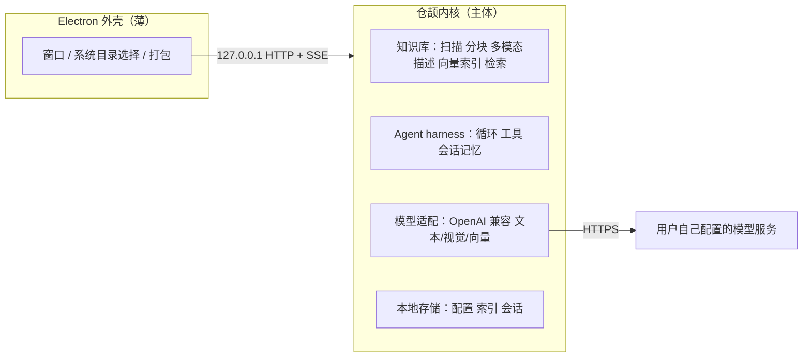

# 架构与分工

## 运行形态

Electron 拉起一个本地的仓颉进程，两者通过只监听 `127.0.0.1` 的 HTTP 通信，生成类接口用 SSE 逐步返回。对外没有任何服务端依赖。



## 为什么内核和外壳走本地 HTTP

内核可以脱离 Electron 单独启动和调试，能用命令行直接验证接口，接口契约可以写成文档长期维护。端口交给系统分配，仓颉把实际端口写到标准输出，外壳读取。

## 分工底线

Electron 侧只允许出现三类代码：创建窗口、调用系统文件对话框、打包配置。任何业务判断都不许写在 JavaScript 里，否则仓颉杯的项目性质就说不清楚了。

## 界面由内核托管

界面文件（`index.html` / `app.js` / `style.css`）由仓颉内核直接以静态资源提供，Electron 只做三件事：拉起内核、读端口文件、把窗口指向 `http://127.0.0.1:<port>/`。这样界面与接口同源，不需要处理跨域，也没有额外的构建步骤。静态资源只放行白名单文件名，其余一律 404，避免路径穿越。

## 打包

`scripts/package-app.ps1` 把 Electron 运行时、应用代码和仓颉内核组装成 `dist/ITN-Desktop/`，并压成 `dist/ITN-Desktop-win-x64.zip`。目录结构：

```text
ITN-Desktop/
  ITN-Desktop.exe          应用入口（Electron 运行时改名而来）
  resources/app/           main.js、renderer/、package.json
  resources/kernel/        itn-desktop-core.exe 与 4 个必需 DLL
  locales/  *.dll          Electron 自带
```

目标机器不需要安装仓颉，也不需要安装 Node。实测约 162 MB。
