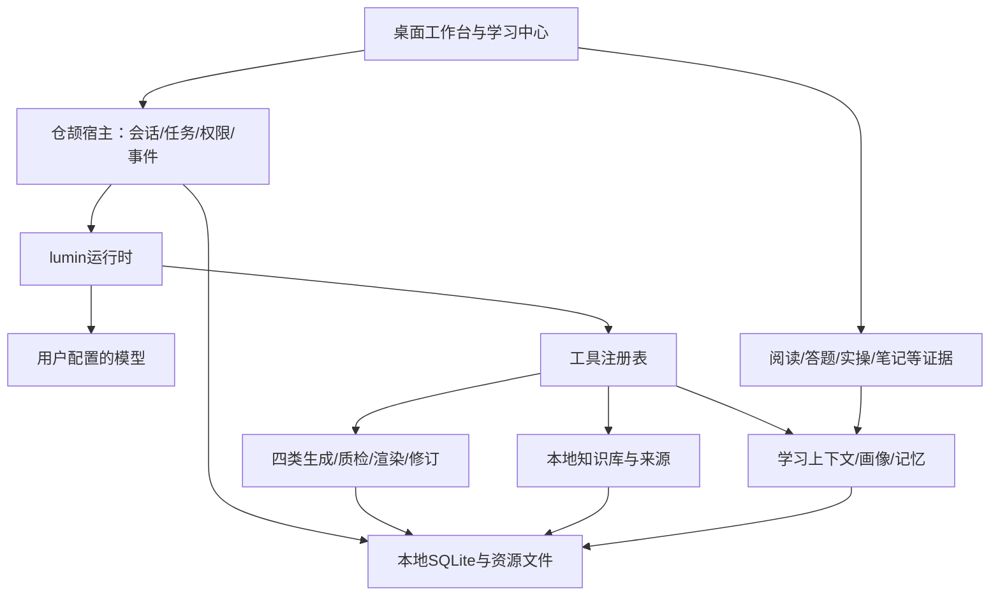
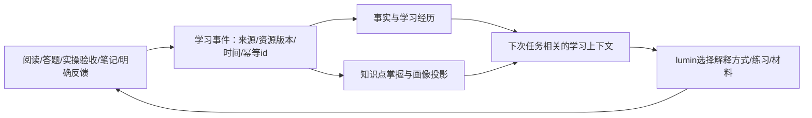

# 个人学习 Agent 工作台：产品与改造方案

日期：2026-10-15。

**状态：完整方案草案，供审阅。本轮仅整理产品与实施设计，未合并资源分支、未改业务代码、未修改数据库或发布新包。**

## 1. 已确认的产品决策

- 定位为个人桌面 Agent，重点是个人学习、学习材料生成、本地知识库、动态学习画像与记忆。
- 保留仓颉与 lumin，以 Agent 工作台为主要交互方向；原有学练、成长、知识网络、笔记与错题能力保留到学习中心。
- 四种资源为：lecture 定制讲义、practice 实操指南、quiz 分阶测试、ppt 在线演示课件。
- 四种资源封装成专业工具，由 lumin 根据用户目标决定是否生成、选择哪种、用哪些资料及是否修订。普通问答不强制生成材料，不默认生成四份。
- 用户明确：演示课件先满足在线播放；可编辑 PowerPoint 导出不作为这一阶段的验收条件。
- lumin 本体保持独立，通过 Desktop 宿主与工具适配扩展个人学习能力。

## 2. 当前能力与缺口

| 领域 | 本轮核对结果 | 处置 |
| --- | --- | --- |
| lumin 执行 | 问答和讲义/练习任务已走 PiAgent.runFull，动态工具、权限、停止与插话已有 | 保留，统一任务生命周期 |
| 对话与列表 | ctxChapter、思考折叠、空态居中、重命名/删除已做 | 复用，迁入工作台组件 |
| 会话恢复 | SQLite有事件；每轮仅恢复最多8条用户/助手文本，未恢复完整历史工具结果 | 改为完整结构化状态恢复与可持续摘要 |
| 前端状态 | 全局state/busyTurn、长HTTP响应与轮询并存 | 按会话/轮次管理，服务端状态为权威 |
| 知识库 | 本地文件/目录导入、组织、检索、网络暂存与确认并入已有 | 增工作区关联、知识点和来源版本关系 |
| 学习画像 | 本机档案、自评、阅读/答题/笔记与成长报告已有 | 建证据事件、知识点掌握状态和可解释投影 |
| 长期学习记忆 | 未发现独立、完整的可追溯记忆生命周期服务 | 新增事实/偏好/学习经历的保存、召回、更正、遗忘 |
| 产物 | 主要按文件目录和名称管理 | 增稳定资源id、版本、来源及学习事件关联 |
| 四类生成 | 独立资源分支已实现结构、质检返修与Markdown渲染，尚未接主线界面 | 选择性迁入专业工具层 |

原会话报告的资源分支70项单测、33项端到端检查属于历史证据，本轮没有重跑，不能代替合并后验证。

## 3. 产品结构与主界面

```text
工作区 / 会话          对话与实际进展             按需打开的内容面板
────────────────────────────────────────────────────────────
新会话                用户目标                   讲义 / 实操 / 测试 / 演示
学习项目 A            Agent简短进展               来源与原文
  梳理知识            可折叠工具记录              当前资料与章节
  生成练习            结果与继续讨论              修改差异 / 历史版本
通用会话
────────────────────────────────────────────────────────────
学习中心              输入框：任务、文件、资料引用
知识库                当前工作区 · 权限 · 发送/停止
学习档案与记忆
设置
```

工作区包含资料目录、关联知识库、学习目标和产物，不等于一个知识库。允许通用会话，不要求先导入资料。一个工作区可关联多个已授权知识库。

主区显示任务、实际进展与结果；工具明细默认折叠，不堆引用计数或固定五步条。右面板按需打开，不长期挤占正文。会话切换不改变后台任务身份，各会话分别显示运行、待批准、已停止或完成状态。

已有学练、成长、知识网络、笔记与错题保留为学习中心的完整能力，不能因聊天简化而失去入口。

## 4. 用户学习闭环

用户导入资料并说明目标 → lumin按需讲解或调用某类资源工具 → 右面板阅读、练习、实操验收和记笔记 → 学习证据更新画像/记忆 → 下一次解释和生成采用更新后的学习上下文。

例如：“我想学RAG，每周4小时，先看我的资料，安排这一周。”Agent可选择先解释、生成讲义、给实操或做诊断题，不机械生成四份。用户继续说“把刚才讲义的例子换成检索应用”，应修改同一资源并形成新版本。重启后任务、材料与学习上下文仍可恢复。

## 5. 技术结构与权威状态



- lumin负责理解目标、选择工具、解释结果与持续执行；学习领域通过工具/技能提供，不再增加另一套固定总流程。
- 宿主管理workspace/session/turn/item/artifact/source身份、任务状态、事件顺序、取消、插话、审批、预算与恢复。
- SQLite作为产品会话与学习记录的权威存储，完整保留消息、tool_call_id、工具结果、产物关系和压缩摘要；通过适配恢复lumin Session。现有JSONL保留兼容/导出用途，不形成两套会分叉的权威历史。
- Agent对象可以常驻，也可以按需重建；完整恢复状态才是关键，不能只保留一个对象或只截几条文本就声称拥有记忆。
- 界面负责输入、展示与用户操作，不猜测任务是否结束，不用单一全局busy标记管理所有会话。
- 渲染层建议组件化和类型化组织，可采用React/TypeScript承担工作台组件与按会话状态管理；这属于待验证选型，不改变仓颉核心分工。实施时先验证Electron内资产构建/打包和离线加载，不复用旧网页版整套导航，不把业务事实藏在前端缓存里。
- 事件应可推送、断线续读和重放；具体采用SSE或stdio等传输在实现前确定。换传输不能替代正确状态管理。会话/轮次/操作项分层可参考[Codex官方生命周期协议](https://learn.chatgpt.com/docs/app-server)，仍由仓颉宿主实现。

## 6. 四类资源作为工具

### 6.1 推荐对外契约（草案，尚未注册）

| 工具 | 用途 | 输入 |
| --- | --- | --- |
| generate_learning_resource | 生成一类学习资源 | kind、topic/brief、sourceRefs、detail、count（可选题数/页数） |
| read_learning_resource | 读取已有材料、版本与来源 | artifactId、version（可选） |
| revise_learning_resource | 按反馈修改同一份材料 | artifactId、baseVersion、instruction、sourceRefs（可选） |
| validate_learning_resource | 检查结构、质量与引用 | artifactId/draftId、version |

统一生成工具内部按四类分派，避免四套保存、权限、取消和版本规则。界面明确显示四种类型，工具schema使用稳定kind枚举。

```json
{"kind":"practice","topic":"用自己的文档搭建最小RAG检索流程","sourceRefs":["source:chapter-3@v2"],"detail":"balanced"}
```

工作区、权限、任务取消令牌、学习画像快照、模型配置和预算由宿主注入；模型不能通过伪造参数改变授权范围或制造学习证据。

### 6.2 lumin与工具的分工

**lumin决定：** 是否生成、选哪类、调用顺序、使用哪些允许的资料、何时修订、怎样说明结果。

**专业工具保证：** 结构、题量/页数、质检与必要返修、引用有效性、渲染、保存、版本和真实进展事件。

资源工具内部可以有该类材料所需的生成/质检阶段，但只在该工具被调用时执行，不能变成每次聊天都走的“先检索→生成四份”。内部模型请求复用同一配置、预算、取消和事件体系，不建立另一个产品主会话。

普通问题直接答；有学习目标时可按需提供资料；大份材料的目标不明时先建议或澄清。快捷按钮把明确意图提交到同一Agent会话，不绕过lumin开隐藏任务。

### 6.3 可用交付标准

| 类型 | 用户得到什么 | 完成判据 |
| --- | --- | --- |
| 定制讲义 | 章节、小节、例子、总结和来源 | 覆盖目标、引用可打开、可继续修改指定小节 |
| 实操指南 | 环境、前置条件、步骤、预期结果、验收和排错 | 验收可勾选并持久化，明确哪些步骤已实测/未执行 |
| 分阶测试 | 可作答题目、答案解析、知识点关联 | 请求题数得到遵守，作答/错题/复习进入学习证据 |
| 在线演示课件 | 幻灯片、目录、讲稿、键盘翻页和续播 | 真正可播放，页数遵循请求，来源可追溯；仅有JSON/Markdown不算完成 |

每份资源保留结构化内容和渲染结果，关联来源版本、画像快照、生成任务与质量报告。取消/失败不能把空占位当作成品。

### 6.4 资源分支接入办法

来源线程：01a13e4a-aa06-7a43-a1c3-4f8a61d0cb59；分支codex/resource-kinds，提交86dd698；工作树D:/Desktop/ITN/ITN-Desktop-res。

已核对：分支含resource/spec、validate、render、generate模块、测试、HTTP路由与文档。输出为结构化内容加Markdown；没有原生PPTX生成器，符合用户本阶段在线演示范围。

旧说明中的“可快进合并”已过期：当前比较是主线独有26个提交、资源分支独有1个提交，不能照旧执行merge --ff-only。

实施步骤：
1. 先迁入结构契约、纯质检、渲染与测试，审查公共文件冲突。
2. 将生成器适配为专业资源服务，接入统一模型、预算、取消、来源上下文和进展。
3. 注册generate_learning_resource；旧HTTP入口如保留，也只调用同一服务，不建立第二条默认Agent链路。
4. 将step事件映射为资源工具的子操作，默认折叠；不恢复全局固定五步条。
5. 修正不合个人学习体验的规则：请求4题不能静默变6题；难度根据请求/画像，不凭空判定零基础。
6. 在当前主线上重新验证四类交付、返修、引用、停止、恢复；历史测试数字不代替本次验收。

## 7. 学习画像与记忆

### 7.1 四类信息分别管理

| 信息 | 内容 | 用途 |
| --- | --- | --- |
| 会话上下文 | 任务、消息、工具结果、产物关系、摘要 | 连续对话与恢复 |
| 个人稳定记忆 | 明确的目标、偏好、时间安排 | 相关任务自动带入，可更正/忘记 |
| 学习经历记忆 | 学过什么、遇到的困难、采取的方法和结果 | 按主题召回，辅助讲解与复习 |
| 知识库内容 | 教材、文档、网页、仓库资料 | 有来源和版本的知识证据，不直接当个人画像 |

### 7.2 证据驱动更新



- 阅读证明接触过内容，不直接等同于掌握；生成多份资料也不直接证明能力提升。
- 自评、明确反馈与客观作答/验收分别保留，不能互相覆盖。
- 先记录知识点证据、样本量、近期表现与置信程度，再形成摘要；不足时显示未知，不造精确分数。
- 普通学习事实与明确偏好自动记录，不每次弹确认；模型推断必须标明依据、推断性质和置信程度。
- 写入幂等，刷新/重放不重复计分；题目关联正确资源版本。
- 更新应能解释依据哪次答题/验收；用户能纠正误记和编辑自评。

### 7.3 记忆生命周期

记忆至少有id、类型、作用域、内容、来源证据、时间、置信度/状态和修订记录。只召回当前任务相关记忆，不把所有个人历史装进每次提示词。

管理页支持查看、编辑、忘记、暂停自动积累。删除对话与忘记相关长期记忆应分别表达清楚；遗忘条目不再被召回，相关画像投影需重算或标记失去依据。

对话总结可形成候选学习经历；“谈到某概念”不自动等于“掌握某概念”。

### 7.4 工具和真实行为的写入边界

- get_learning_context：读取相关目标、偏好、掌握证据与复习点。
- remember_learning_fact：记录有当前消息/事件依据的明确事实或偏好；无依据推断进入候选状态。
- 作答、阅读、实操证据来自实际UI/执行器；正确性由题目答案/验证结果判定，不能让模型任意写“已掌握100分”。
- 更正、遗忘与查看响应用户直接要求，保留必要的版本/来源关系。

首版记忆采用结构化事实、作用域与主题索引；语义检索作为可扩展能力，不预先引入图数据库。新的用户明确更正优先于旧推断，失效条目保留修订关系但不参与当前召回。

现有六维“实测参考”中以阅读比例、产物数、笔记数代理能力的部分，迁移时应归类为行为统计，不继续当作知识掌握分。知识点掌握依据作答、验收等证据单独表达；自评仍保留。

## 8. 数据与迁移设计（候选结构，尚未建表）

| 领域 | 结构需求 | 兼容方式 |
| --- | --- | --- |
| 会话/工作区 | 库关联、会话配置、turn/item、完整消息与摘要 | 沿用sessions/session_events身份，不删除旧历史 |
| 资源 | artifact登记、版本、结构化内容、来源、生成/质量记录 | 旧文件登记legacy版本，不伪造缺失来源或画像 |
| 学习 | learning_events、知识点身份、证据、画像投影/快照 | 旧progress/quiz_records/notes回填标明legacy和字段边界 |
| 记忆 | memory_items、证据关系、修订/遗忘状态、索引 | 与对话原文/知识库分开，避免重复权威数据 |
| 来源 | source与文档/切片/资源版本关系 | 兼容暂存清单，增加稳定sourceId和有效链接 |

资源文件存本机受管目录，SQLite保存索引、关系与必要结构化状态。修改产生新版本和当前指针，旧版可恢复；重命名不改变资源身份。

先用旧数据副本验证迁移，保留配置、库、会话、笔记、错题和记录。引入schema版本与迁移记录，不能仅靠CREATE TABLE IF NOT EXISTS假设改列也已处理。

## 9. 实施阶段与验收

| 阶段 | 范围 | 必须通过的验收 | 状态 |
| --- | --- | --- | --- |
| A | 定位、方案与资源分支审查 | 区分已实现/拟实现，明确在线播放范围和分支冲突点 | 草案已整理，待审阅 |
| B | 会话/任务与资源身份基础 | 超过8条消息仍能引用早期工具结果；重启恢复；取消/插话按轮次正确；资源有id/版本 | 未实施 |
| C | 四类资源工具接入 | 按需选择；普通问答不触发；四类交付/返修/引用/停止；题数不被暗改 | 未实施 |
| D | 桌面工作台 | 默认主入口；材料/来源同屏；连续修改和差异；学习中心入口仍可达 | 未实施 |
| E | 动态画像与记忆 | 真事件更新可解释；重放幂等；更正/遗忘有效；下次生成采用更新上下文 | 未实施 |
| F | 整体迁移与稳定发布 | 旧库迁移、端到端任务、真实模型抽查、打包/源码一致、固定版本入口 | 未实施 |

推荐B→C→D→E→F。B先定义学习事件和画像快照接点，C先用现有档案快照，E扩展动态证据，避免四类生成成为一套接不上画像的孤立配置。

每阶段更新正式接口契约和TRACE，功能完成后本地Git提交。实现期间不改lumin本体、不混入网页版改动。

### 9.1 可执行检查清单（全部待实施）

- [ ] B0：验证本地增量事件通道与断线重放；确定传输方式后再定正式接口。
- [ ] B1：在session/pi_app中建立会话、轮次、操作项和取消令牌的统一管理，权限/停止/插话都绑定实际turnId。
- [ ] B2：在db/session中保存并恢复结构化消息、工具调用结果、摘要与资源关系，去掉仅8条文本的恢复限制。
- [ ] B3：建立资源登记/版本和学习事件接点；旧文件以legacy身份登记，旧数据迁移有版本和回滚验证。
- [ ] C1：审查86dd698与当前主线冲突，迁入resource结构/质检/渲染及测试，不执行已过期的快进命令。
- [ ] C2：适配资源生成服务并注册生成/读取/修订/验证工具；预算、取消和进展与主任务相通。
- [ ] C3：接入来源和画像快照，修正题数/难度规则；四类均保留结构化内容和质量报告。
- [ ] C4：贯通可读讲义、可验收实操、可作答测试和可播放演示，学习动作写入证据。
- [ ] D1：拆分当前大app.js的导航、会话、执行时间线、输入区和资源预览职责。
- [ ] D2：实现左工作区/会话、中对话、右材料/来源/差异；同资源持续修改、版本切换与恢复。
- [ ] D3：设置工作台默认入口，迁移学习中心/知识库/档案入口，并验证旧功能仍可到达。
- [ ] E1：实现幂等学习事件和知识点证据投影，区分事实、自评和推断。
- [ ] E2：实现记忆查看、更正、遗忘、召回与自动积累开关；删除对话的相关语义明确。
- [ ] E3：把更新后的学习上下文接回lumin和四类生成，验证个性化变化有真实依据。
- [ ] F1：在旧库副本验证迁移；运行端到端主线与停止/恢复/遗忘专项。
- [ ] F2：用真实模型检查内容与来源质量，明确未经验证部分，不用mock成功代替内容正确。
- [ ] F3：形成固定稳定启动入口、可见版本号与发布回滚记录；对包内资产/内核作一致性核验。

对应模块位置是实施范围建议，不是已经创建的新接口或数据库结构。

## 10. 端到端验收任务

1. 简单概念直接回答，不无故生成资料或遍历全部库。
2. 要求实操只生成实操；明确要求学习包时才按目标组合四类并给出交付清单。
3. 讲义可读改、实操可验收、测试可答、演示可翻页续播，来源可打开。
4. 超过8条消息和多轮工具后仍能修改同一份材料，重命名不丢引用。
5. 模型静默、联网、审批、长资料生成时能停；切会话不误停；终态不依赖长HTTP响应。
6. 答题/实操后证据、错题/复习和画像更新；下次解释/资料能体现变化并说明依据。
7. 更正偏好后采用新值；忘记经历后不再召回；阅读或谈论不被误算高掌握分。
8. 重启恢复会话和产物，旧数据不丢；中断草稿能继续或重做，不伪装成成品。
9. 应用内显示版本/提交/数据目录，固定启动入口指向稳定发布，减少多个试跑目录混淆。

## 11. 当前方案边界

本轮是产品与实施方案，不表示已经建成新工作台或注册四类生成工具。在线播放已确认；PowerPoint导出以后单独规划。云同步、多人协作、移动端不纳入本次改造。

建议用户确认整体方案和阶段顺序后，再从B实施。后续已授权阶段中的日常实现选择无需反复索取许可。

